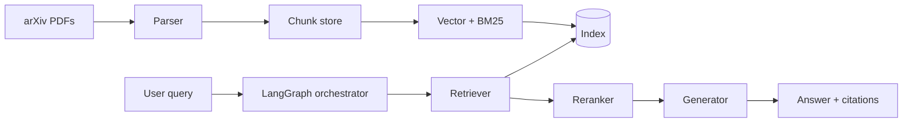

# 架构概览

## 数据流（目标态）

## 当前实现（M0 脚手架）

- **Parser**：`src/parser/pdf_parser.py`（PyMuPDF）
- **Indexer**：分块 + JSONL 合并（无向量）
- **Retriever**：`retriever/baseline.py` 关键词 overlap
- **Generator**：`generate/baseline.py` stub
- **Orchestrator / Rerank / Agentic**：空模块或脚本 stub

## 配置与入口

- 配置：`configs/default.yaml`
- CLI：`scripts/*.py`
- 库：`src/`

## 部署形态（远期）

单机 / 云端代理均可：无状态 API 可选；索引与 PDF 本地磁盘或对象存储。
