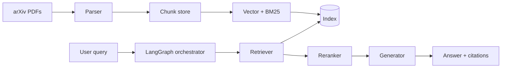

# 架构概览

## 数据流（目标态）

## 当前实现（M1 Baseline）

- **Parser**：`src/parser/pdf_parser.py`（PyMuPDF，页文本 + 固定字符分块）
- **Indexer**：`src/indexer/build.py` — sentence-transformers 嵌入 + FAISS；可选 BM25 侧车
- **Retriever**：`retriever/baseline.py` — 稠密 FAISS；`hybrid.enabled` 时 BM25 + RRF
- **Generator**：`generate/baseline.py` — 默认 stub；可选 OpenAI 兼容 chat API
- **Orchestrator / Rerank / Agentic**：`scripts/run_agentic.py` 等仍为 M2 stub

## 配置与入口

- 配置：`configs/default.yaml`
- CLI：`scripts/*.py`
- 库：`src/`

## 部署形态（远期）

单机 / 云端代理均可：无状态 API 可选；索引与 PDF 本地磁盘或对象存储。
