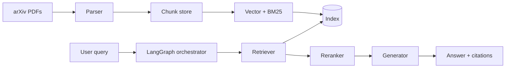

# 架构概览

## 数据流（目标态）

## 当前实现（M2）

- **Parser**：`src/parser/pdf_parser.py`（PyMuPDF，页文本 + 固定字符分块 512/64）
- **Indexer**：`src/indexer/build.py` — sentence-transformers 嵌入 + FAISS；可选 BM25 侧车
- **Retriever**：`retriever/baseline.py` 稠密 + RRF；`retriever/pipeline.py` 统一入口 + 可选 rerank
- **Reranker**：`src/rerank/cross_encoder.py`（CrossEncoder，`retriever.reranker` 配置）
- **Generator / LLM**：`generate/baseline.py` + `generate/llm.py`（stub / OpenAI 兼容；默认 DeepSeek 端点示例）
- **Prompts**：`prompts/*.txt`（grade / rewrite / generate）
- **Orchestrator**：`src/agent/graph.py`（LangGraph）；CLI `scripts/run_agentic.py`
- **Eval**：`scripts/eval_all.py` → `data/eval/runs/` + `docs/reports/smoke_m2_agentic.md`

## 配置与入口

- 配置：`configs/default.yaml`
- CLI：`scripts/*.py`
- 库：`src/`

## 部署形态（远期）

单机 / 云端代理均可：无状态 API 可选；索引与 PDF 本地磁盘或对象存储。
